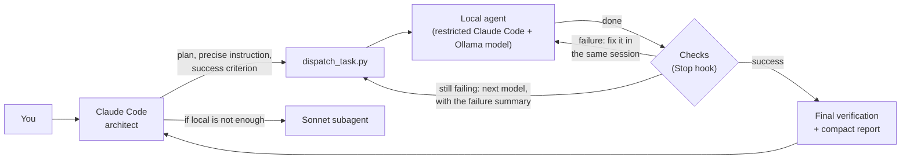

# /local — local agents for Claude Code

[](https://github.com/MartinG-38/claude-local-agents/actions/workflows/tests.yml)

**Claude Code designs, plans and checks; open models running on your own machine
(through [Ollama](https://ollama.com)) do the heavy lifting.**
Goal: spend fewer Claude tokens without lowering the quality of the results, with strong security and
no use of Ollama's cloud whatsoever.

macOS, Linux and Windows · Python 3.8+ with no dependencies · any local Ollama model.

> **Status: experimental.** The test suite (simulations) passes on Linux and macOS, and the
> acceptance test has passed on a real Mac (Apple Silicon). Windows and real Linux machines have not
> been validated yet: feedback welcome.

**Is it for you?** You use Claude Code, your quota matters, and your machine can run a capable local
model: in practice **~24 GB of memory usable by the models** (a GPU, or a Mac with 32 GB or more) for
code tasks. With less, local models still answer questions about big files and logs, but agent tasks
are unreliable.

---

## The idea

Claude is excellent at understanding a project, designing and judging, but every file it reads and
every line it writes eats into your quota. Local models are free and good at volume: reading logs,
exploring code, writing well-specified code, making tests pass.



Each local agent is an instance of Claude Code in restricted mode, connected to Ollama's
Anthropic-compatible API (`http://localhost:11434`): it has Claude Code's tools (read, edit, search),
but your local model does the thinking. Claude only reads the **final report** (about twenty lines),
not the tens of thousands of tokens exchanged locally.

## Features

- **Delegates only what pays off**: large reads first (logs, test output, big files, code to explore),
  then code in volume. Small edits, architecture, decisions and hard debugging stay with Claude.
- **Three tools**: a question about content you provide (`ask_local.py`), a read-only code
  exploration (`delegate_local.py --readonly`), a checked code task (`dispatch_task.py`).
- **Automatic checks**: your tests run in a network-less sandbox when the agent says it is done; the
  agent fixes failures in the same session. Optional held-out tests the agent never sees, and a review
  by another local model. Claude reviews before committing and can reject with precise remarks.
- **Model chain**: if a model still fails, the next one takes over with a summary of the failure, or
  continues its work if it made tests pass. The best attempt is always kept.
- **Controlled escalation**: a Sonnet subagent when local is not enough; web research by a Claude
  subagent (can be turned off). Local agents **never** have Internet access.
- **Plan mode** (`/local plan <goal>`): design, a plan of attack for your approval, task-by-task
  execution, wrap-up.
- **It learns your models**: each failure mode (output limit, going in circles, wandering…) adds a
  matching rule to that model's next instructions, and the size of task each model can handle is
  learned from real results. All of this is kept in files Claude does not read, at almost no token cost.
- **Your work is never thrown away**: modified tracked files stop a task (commit them first), your
  untracked files are left alone, and rejected work goes to `git stash` or a branch, always recoverable.
- **Memory-aware**: the skill knows each model's footprint and picks the best model that fits;
  independent tasks can run in parallel in separate `git worktree`s.

Example of the report Claude receives after a task (everything else stayed local; the model names are
only examples):

```
== Task 3: passed (check OK) after 2 attempt(s) and 1 in-session fix(es) ==
  Local models tried: gpt-oss:20b (failed) → qwen3.8:27b (passed)
  [agent] gpt-oss:20b | done | steps 7 | 1.8 min | local tokens: 41200 read, 900 written
  [agent] qwen3.8:27b | done | steps 9 | 2.6 min | local tokens: 52800 read, 1100 written
== Security: 14 actions checked, 0 blocked, 1 approved by the local expert ==
== Changed files == src/export.py (+24 −3)
  new: def export_invoices(invoices, path, *, sep=";")
Work of failed models set aside (1): see git stash list
Estimated Claude tokens saved by this task: ≈ 5,000 tokens saved in input equivalent (input: saved ~2,950 · output: saved ~410) — rough estimate.
```

## What to expect

Savings depend on your machine and models. They are clearest on reads (logs, test output, big files,
code exploration) and on well-specified code covered by tests; a code task takes minutes rather than
seconds. `/local saved-tokens` shows the real net figure for your own use, and
[How many tokens are saved?](docs/savings.md) explains how it is counted.

## Requirements

- An up-to-date [Claude Code](https://docs.claude.com/en/docs/claude-code) (`claude update`), git,
  Python 3.8+.
- A recent [Ollama](https://ollama.com) (0.14 or later for its Anthropic-compatible API; on Apple
  Silicon, 0.40 or later for the much faster MLX engine). `/local doctor` checks all of this.
- At least one local model **with tool calling** (`tools`) for code tasks, and a context of at
  least 32k (64k recommended).
- Linux: the `bubblewrap` package.

## Installation

On Windows, type `py` or `python` instead of `python3`.

**1. Prerequisites**

- [Claude Code](https://docs.claude.com/en/docs/claude-code), up to date (`claude update`).
- git and Python 3.8+ (macOS: `xcode-select --install` provides both).
- [Ollama](https://ollama.com/download): the app on macOS and Windows; on Linux, the install script
  from that page. No Ollama account is needed: the skill only runs models on your machine.
- Linux only: the `bubblewrap` package (`sudo apt install bubblewrap`, `sudo dnf install bubblewrap`…),
  the sandbox of the checks.

**2. Install the skill**

```bash
git clone https://github.com/MartinG-38/claude-local-agents.git
cd claude-local-agents
python3 install.py --ollama-settings --claude-md          # add --block-cloud to block Ollama's cloud
```

- `--ollama-settings`: 64k context and models kept loaded 30 min, in a way that survives a restart
  (if you skip it, the skill applies the same settings by itself at the first session).
- `--claude-md`: adds a short instruction to `~/.claude/CLAUDE.md` so that Claude thinks of the skill
  even when you do not mention it.
- `--block-cloud` (optional): also blocks Ollama's cloud on Ollama's side, for everything that uses
  Ollama on this machine. Without it, the skill still never uses the cloud: its scripts refuse cloud
  models and remote servers.

> **What the installer changes on your machine**
>
> | Where | What | When |
> |---|---|---|
> | `~/.claude/skills/local/` | the skill (a previous version is backed up, never deleted) | always |
> | `~/.claude/local-agents/models.md` | your models and preferences (created once, never overwritten) | always |
> | `~/.claude/CLAUDE.md` | a 3-line block marked `<!-- skill /local -->` | `--claude-md` |
> | Ollama's environment | `OLLAMA_CONTEXT_LENGTH`, `OLLAMA_KEEP_ALIVE` (and `OLLAMA_NO_CLOUD` with `--block-cloud`): macOS a login agent `~/Library/LaunchAgents/local.ollama.env.plist`; Windows user variables (`setx`); Linux: it prints the `sudo systemctl edit ollama` lines for you to add | `--ollama-settings`, or the first session |
> | `~/.ollama/server.json` | `"disable_ollama_cloud": true` | `--block-cloud` |
>
> While in use, the skill also writes per-task logs in `<repository>/.git/local-agents/` (never
> committed), statistics in `~/.claude/local-agents/memory.json` and `~/.local/share/local-agents/`,
> and `/local saved-tokens` reads Claude Code's transcripts in `~/.claude/projects` to measure the real
> cost (sizes only are recorded). Nothing leaves your machine. Details: [Files and folders](docs/reference.md#files-and-folders).

**3. Once, after the installation** (the installer reminds you)

- macOS: remove Ollama from System Settings → General → Login Items ("Open at Login"), so that it
  starts after the variables; leave the app's "Context length" setting alone (and its "Cloud" switch,
  if you blocked the cloud) and keep "Expose Ollama to the network" off.
- Quit Ollama (menu bar or taskbar icon → Quit) and reopen it, so that it uses the settings.

**4. Choose and download your models**

```bash
python3 ~/.claude/skills/local/scripts/doctor.py --suggest   # proposals for this machine's memory
ollama pull <model>                                          # never a tag ending in -cloud
```

Then, in Claude Code, `/local models` lists the installed models with what each can do and adds the
ones you pick to `models.md`. Any local model with tool calling works; see
[Choosing models](docs/configuration.md#choosing-models).

**5. Check the installation**

```
/local doctor             in Claude Code: Claude Code, Ollama, sandbox, context, models, cloud block
```

```bash
python3 tests/acceptance.py            # from the cloned folder; Windows: set LOCAL_ALLOW_UNSANDBOXED=1 first
```

The acceptance test (5–20 min, local models only, in a temporary repository) runs the real chain: it
verifies that Claude Code really runs the guard and the Stop hook, that the sandbox holds, that your
model fixes code and calls tools, and writes `acceptance-report.md`.

**6. Calibrate your models**

```
/local calibrate --quick
```

It measures each model (speed, code tasks, reading questions) and suggests a task size per model;
Claude writes the results into `models.md`. You are ready: Claude now delegates by itself whenever a
task lends itself to it.

### Update

`git pull` in the cloned folder (or unzip the new archive over the old folder), then
`python3 install.py` again. Your `models.md`, calibration results, task sizes and Ollama settings are
kept; the previous version of the skill is backed up.

### Uninstall

`python3 install.py --uninstall` removes the skill (a backup is kept) and the block it added to
`~/.claude/CLAUDE.md`; your `models.md` stays. The Ollama settings stay too. To remove them:

- if you blocked the cloud: `python3 ~/.claude/skills/local/scripts/ollama_settings.py --allow-cloud`
  *before* uninstalling;
- macOS: `launchctl bootout gui/$(id -u) ~/Library/LaunchAgents/local.ollama.env.plist`, then delete
  that file;
- Windows: delete the user variables `OLLAMA_CONTEXT_LENGTH`, `OLLAMA_KEEP_ALIVE` (and
  `OLLAMA_NO_CLOUD`) in System Properties → Environment Variables;
- Linux: remove the lines you added with `sudo systemctl edit ollama`.

## Usage

Usually there is nothing to do: Claude uses the skill whenever a task lends itself to it. You can
also ask for it:

```
/local summarize the errors in logs/app.log and tell me which ones come from our code
/local write the missing docstrings in src/geometry/
/local plan add a CSV export of invoices, with tests
```

The most useful commands:

| Command | What it does |
|---|---|
| `/local doctor` | full diagnostics: Claude Code, Ollama, sandbox, context, models, memory |
| `/local models` | screens the models installed in Ollama and adds the ones you pick |
| `/local calibrate [--quick]` | measures your models and suggests a task size for each |
| `/local plan <goal>` | plan mode: design, plan for your approval, execution, wrap-up |
| `/local --force-model 27b,glm <task>` | uses exactly these models, in this order, for this prompt only: nothing is saved (short names work; commas between them). Without it, the models are chosen from what was learned on your previous tasks |
| `/local size [<size>]` | shows or sets how big a delegated task may be |
| `/local settings` | Ollama settings (context, keep-alive, optional cloud block) |
| `/local unload` | frees the memory held by loaded models |
| `/local saved-tokens` | tokens saved in this conversation, net of the skill's own cost |

You can also ask in plain words ("set the context to 96k", "how many tokens did we save?"). A code
task runs in the background and its shell shows live progress (`/tasks` in Claude Code); following
it costs no Claude tokens. All commands, scripts and options: [Reference](docs/reference.md).

## Security

It is built in layers. None is perfect on its own; together they strongly limit what a local model
can do wrong.

| Layer | What it guarantees |
|---|---|
| **No cloud** | Ollama cloud models (`cloud` tag, `remote_host` field) and any non-local server are always refused by the scripts. Optional extra lock on Ollama's side (`--block-cloud`). |
| **Restricted agent** | Claude Code started with `--restricted`, without MCP servers, without web tools, with only the tools it needs (no shell unless explicitly requested). |
| **Guard on every action** | A Claude Code hook checks every action before it runs: files inside the project only, writes limited to the allowed paths (`--write`), never `.git`, `.claude` or secrets (`.env`, keys…). For the shell: a denylist, an allowlist, and a gray zone judged by a local "security expert" model; without a clear answer, refused. |
| **Sandboxes** | The agents' shell runs in Claude Code's sandbox (no network; secrets unreadable even through `grep -r`). Checks run in `sandbox-exec` (macOS) or `bubblewrap` (Linux): no network, project read-only, no access to the user's other processes or session services (D-Bus, Docker), secrets and held-out tests masked. Without a sandbox (Windows, Linux without bubblewrap), checks are refused unless you set `LOCAL_ALLOW_UNSANDBOXED=1`. |
| **Environment** | Agents and checks get an environment without tokens, keys or cloud credentials (`LOCAL_KEEP_ENV="NAME"` passes a variable through, e.g. a dummy key the tests read). |
| **git** | A clean repository is required, failed attempts are set aside, diffs are reviewed by Claude before every commit. |

**Windows**: no sandbox for the checks (refused unless `LOCAL_ALLOW_UNSANDBOXED=1`) and no shell for
the agents. WSL2 is recommended.

Found a vulnerability? Please report it privately: see [SECURITY.md](SECURITY.md).

## Known limitations

- Local models are not as good as Claude at designing or debugging a subtle problem: that is why
  Claude writes (or has Sonnet write) the tests that serve as the specification, checks, and
  escalates.
- Local is slower: a task often takes a few minutes.
- Reasoning settings vary from one model to another; they are adapted automatically, but not yet
  validated on every real model.
- Memory estimates are approximate until a model has been measured.
- The guard greatly reduces the risks without being an absolute guarantee: work on version-controlled
  repositories and review the diffs (Claude does it for you). With a shell (`--tools` with `Bash`),
  an agent can still read `.git/config`: do not put credentials in remote URLs.
- The proof that tests ran (pytest report, unittest summary) protects against accidents, not against
  code deliberately written to fool the test runner: the held-out tests and Claude's diff review are
  there for that.
- The macOS sandbox profile allows by default and denies targeted operations (network, writes, secret
  folders, a few system commands); it is less strict than bubblewrap on Linux. `/local doctor` and
  the acceptance test run its self-test on your machine, and CI runs it on macOS.
- The skill relies on Claude Code command-line options, settings and hooks that may change;
  `/local doctor` checks the options, and a task whose hooks did not run is refused.
- Checks that build into the project (make, tsc…) need `--check-writable`, which protects `.git`,
  virtual environments and secret files; other files git ignores are not protected, but any one
  created, modified or deleted during the task is listed in the report.

## Documentation

- [How it works](docs/how-it-works.md): how a task is verified, following a task live, plan mode.
- [Configuration](docs/configuration.md): Ollama settings, `models.md` preferences, choosing models,
  task size, memory and parallelism.
- [How many tokens are saved?](docs/savings.md): what the skill costs, how savings are estimated and
  measured.
- [Reference](docs/reference.md): every command, script, option, exit code, environment variable and
  file; repository layout.

## Tests

```bash
python3 tests/run_tests.py        # ~2 min, no Ollama or Claude account needed; Linux and macOS
python3 tests/test_tools.py       # profile_data.py and make_notebook.py
python3 tests/acceptance.py       # on a machine with Ollama and Claude Code: the real chain
```

`run_tests.py` replays 49 scenarios with a fake Ollama server and a fake `claude`: the guard (43
cases), cloud refusal, the model chain, review, rejection, research, sandbox failures, adversarial
cases (a test rewritten outside `--write`, checked code deleting `.env` or exiting before the tests,
code tailored to the visible tests, misleading review verdicts, hooks that do not run, shell tricks
against the guard, secret variables), task size, learning from failures, token savings, installation
and more. `python3 tests/run_tests.py -k <name>` runs some of them, `-v` shows details.

GitHub Actions runs both suites on every push, on Ubuntu (bubblewrap) and macOS (sandbox-exec), with
Python 3.8 and 3.13, after a self-test of the sandbox.

## Contributing

Bug reports, results on your machine (especially Windows and Linux) and pull requests are welcome:
see [CONTRIBUTING.md](CONTRIBUTING.md). Changes are listed in [CHANGELOG.md](CHANGELOG.md).

## License

[MIT](LICENSE) © 2026 Martin Guillemaud. You may use, modify and redistribute this project,
including commercially, as long as the copyright notice and the license are kept.
If you build on it, a link back to this repository is appreciated.

---

Independent project, not affiliated with Anthropic or Ollama.

Developed with the help of [Claude Code](https://claude.com/claude-code) (Anthropic) as a coding assistant.
